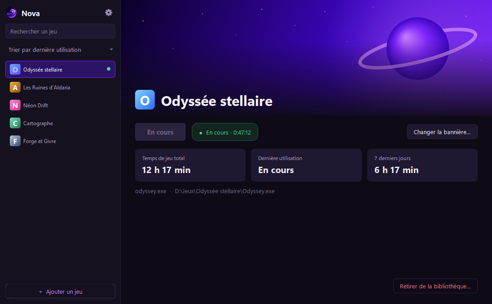
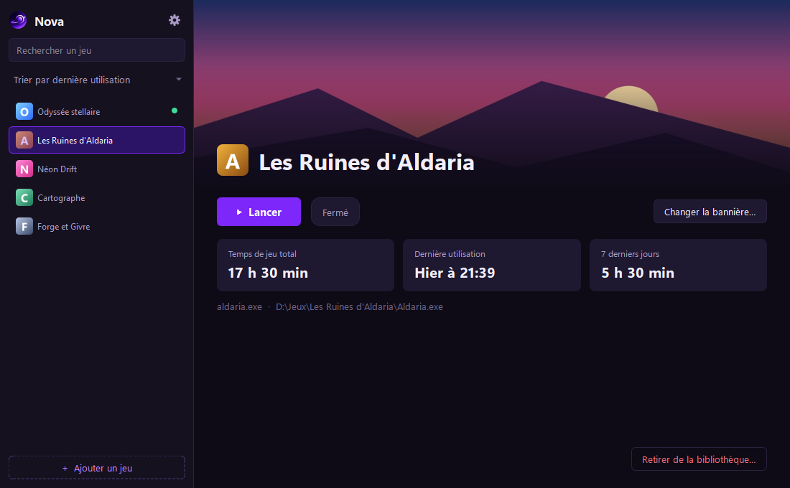
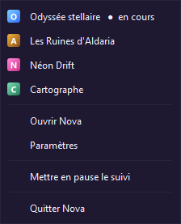

<p align="center">
  
</p>

<h1 align="center">Nova</h1>

<p align="center">
  Nova mesure automatiquement le temps que vous passez sur vos jeux, sans avoir à les lancer depuis elle.<br>
  Elle tourne discrètement et présente votre bibliothèque dans une interface sombre et moderne.
</p>

<p align="center">
  <a href="../../releases/latest"><b>Télécharger la dernière version</b></a>
</p>



| Bannière personnalisée | Menu de la zone de notifications |
|---|---|
|  |  |

*Captures réalisées avec des jeux fictifs.*

## Fonctionnalités

- **Suivi automatique** : dès qu'un jeu de votre liste est lancé, par n'importe quel moyen (Steam, Epic, Riot, raccourci…), son temps est compté. Fonctionne aussi avec les jeux protégés par un anti-triche.
- **Statistiques par jeu** : temps total, dernière utilisation, temps des 7 derniers jours, et compteur en direct pendant une partie.
- **Ajout simple** : choisissez le jeu parmi les programmes en cours (le plus sûr), sélectionnez son fichier `.exe`, ou tapez son nom de processus. L'icône et le nom sont récupérés automatiquement.
- **Bibliothèque à la Steam** : recherche, trois tris (dernière utilisation, temps de jeu, ordre alphabétique), bannière par défaut ou image de votre choix, bouton « Lancer ».
- **Discrète** : fermer la fenêtre la range parmis les applications minimisées. Menu du clic droit, pause du suivi, démarrage avec Windows, une seule instance à la fois.
- **Fiable** : la veille du PC n'est pas comptée, un crash ou une coupure de courant fait perdre au plus une minute, la bibliothèque est sauvegardée chaque jour et restaurée si elle est abîmée.
- **Légère** : environ 0 % de processeur et 25 à 45 Mo de mémoire quand elle tourne en arrière-plan.

## Installation

1. Téléchargez `Nova-<version>-windows.zip` depuis la page [Releases](../../releases/latest).
2. Extrayez le dossier `Nova` où vous voulez (par exemple dans `Documents`), puis lancez `Nova.exe`.
3. Au premier lancement, Windows SmartScreen peut afficher un avertissement, car l'exécutable n'est pas signé : cliquez sur « Informations complémentaires », puis « Exécuter quand même ».

`Nova.exe` doit rester dans son dossier, à côté du dossier `_internal` dont il a besoin. Pour le lancer depuis le bureau, créez plutôt un raccourci : clic droit sur `Nova.exe`, « Afficher d'autres options », « Envoyer vers », « Bureau (créer un raccourci) ».

Aucune installation de Python n'est nécessaire. Vos données restent sur votre PC, dans `%APPDATA%\Nova` : Nova ne fait aucune connexion réseau.

**Désinstaller** : décochez « Lancer Nova au démarrage de Windows » dans les paramètres, quittez Nova (clic droit sur l'icône, « Quitter Nova »), puis supprimez le dossier `Nova` et, si vous le souhaitez, `%APPDATA%\Nova`.

## Développement

Prérequis : Windows 10 ou 11 et [Python 3.14](https://www.python.org/downloads/windows/).

```powershell
py -3.14 -m venv .venv
.venv\Scripts\python -m pip install -r requirements-dev.txt
.venv\Scripts\python -m nova                     # lancer Nova
.venv\Scripts\python -m pytest                   # tests automatisés
.venv\Scripts\python -m ruff check .             # qualité du code
.venv\Scripts\python tools\build_release.py      # construire Nova.exe et l'archive .zip
```

`tools\probe_tracking.py` permet aussi de vérifier le suivi d'un vrai jeu dans une console.

### Organisation du code

Le code (`src/nova`) est découpé en couches, avec des règles d'import vérifiées par un test :

| Dossier | Rôle |
|---|---|
| `core` | Moteur de suivi : détection des processus, sessions, veille. Aucune dépendance à Qt ni à SQLite, donc testable sans interface. |
| `data` | Base SQLite : jeux, sessions, statistiques, sauvegardes. |
| `services` | Thread de suivi, bibliothèque, lancement des jeux : le lien entre le moteur, la base et l'interface. |
| `system` | Intégrations Windows : chemins, icônes, démarrage automatique, instance unique. |
| `ui` | Interface PySide6 : fenêtre, fiche, systray, thème. |

## Stack technique

| Élément | Choix |
|---|---|
| Langage | Python 3.14 |
| Interface | PySide6 (Qt 6), thème QSS |
| Base de données | SQLite (module `sqlite3`) |
| Détection des processus | psutil |
| Tests et qualité | pytest, ruff |
| Distribution | PyInstaller |

## Licence

Nova est distribuée sous licence [MIT](LICENSE). Elle s'appuie sur Qt et PySide6 (LGPL v3) et sur psutil (BSD) : voir [THIRD_PARTY_NOTICES.md](THIRD_PARTY_NOTICES.md).
